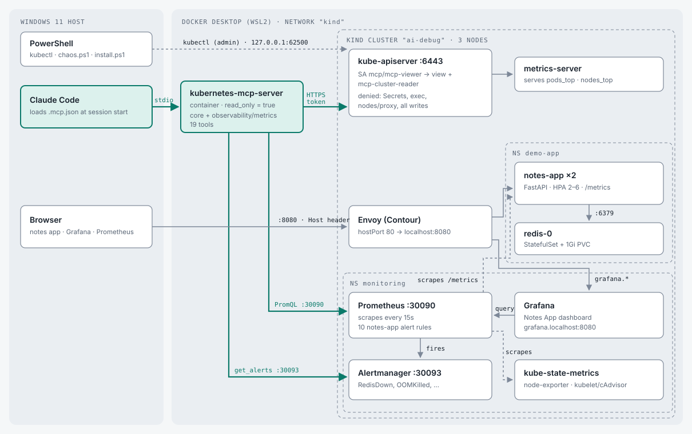
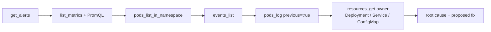

# k8s-ai-debugger

Monitor and debug a Kubernetes cluster with **Claude + MCP**.

A small FastAPI app runs on a local 3-node [kind](https://kind.sigs.k8s.io/) cluster
with Prometheus, Alertmanager and Grafana. Claude Code connects to the cluster through
the open-source [`kubernetes-mcp-server`](https://github.com/containers/kubernetes-mcp-server)
(read-only, 19 tools) and investigates incidents the way an on-call engineer would:
alerts → metrics → pods → events → logs → root cause → proposed fix.
A chaos script breaks the app in 9 realistic ways so you can practise.



*Teal is the AI path. Claude Code starts the MCP server container over stdio; the
container calls the Kubernetes API with a read-only ServiceAccount token and queries
Prometheus/Alertmanager over NodePorts on the `kind` Docker network. Your browser
reaches the app and Grafana through Envoy on `localhost:8080`.*
An interactive version of the diagram is in [`docs/architecture.html`](docs/architecture.html).

---

## Contents

- [What's inside](#whats-inside)
- [Repository layout](#repository-layout)
- [Prerequisites](#prerequisites)
- [Runbooks: setup](#runbooks-setup)
  - [RB-1 Build the app image](#rb-1-build-the-app-image)
  - [RB-2 Create the kind cluster](#rb-2-create-the-kind-cluster)
  - [RB-3 Deploy add-ons and the app](#rb-3-deploy-add-ons-and-the-app)
  - [RB-4 Install monitoring](#rb-4-install-monitoring)
  - [RB-5 Connect the MCP server to Claude Code](#rb-5-connect-the-mcp-server-to-claude-code)
  - [RB-6 Verify the MCP server](#rb-6-verify-the-mcp-server)
- [Runbooks: break and debug](#runbooks-break-and-debug)
  - [RB-7 Run a chaos scenario](#rb-7-run-a-chaos-scenario)
  - [Incident runbooks by alert](#incident-runbooks-by-alert)
- [Runbooks: operations](#runbooks-operations)
- [Troubleshooting](#troubleshooting)
- [Talking to the cluster through Claude](#talking-to-the-cluster-through-claude)
- [Security model](#security-model)

---

## What's inside

| Layer | What | Notes |
|---|---|---|
| App | `notes-app` (FastAPI) + Redis | `/healthz`, `/readyz`, `/metrics`, JSON logs, and `/chaos/*` endpoints that crash, leak memory, burn CPU or fail readiness on purpose |
| Cluster | kind `ai-debug`: 1 control-plane + 2 workers | Kubernetes v1.37, metrics-server, Contour/Envoy ingress on `localhost:8080`, HPA |
| Observability | kube-prometheus-stack 93.6.1 | Prometheus, Alertmanager, Grafana, kube-state-metrics, node-exporter; PodMonitor for the app; 10 app alert rules; *Notes App* dashboard |
| AI access | `kubernetes-mcp-server` (container, pinned digest) | `core` + `observability/metrics` toolsets, `read_only = true`, Secrets denied, dedicated read-only ServiceAccount |
| Practice | `scenarios/chaos.ps1` | 9 failure scenarios, `-Random` mystery mode, one-command reset, answer key |

Real, unedited transcripts of Claude using these tools are in
**[docs/mcp-examples.md](docs/mcp-examples.md)**: health check, PromQL, a crash-looping
release and an alert-driven Redis outage.

## Repository layout

```
app/                    FastAPI notes app, Dockerfile, smoke tests
cluster/kind-config.yaml  3-node kind cluster, ports 8080/8443 mapped to the control plane
k8s/base/               namespace, Redis StatefulSet, app Deployment/Service/Ingress/HPA (kustomize)
k8s/addons/             metrics-server + Contour, vendored and patched for kind (kustomize)
monitoring/             kube-prometheus-stack values, install script, app PodMonitor/alerts/dashboard
mcp/                    RBAC, kubeconfig generator, server config.toml, Claude registration, smoke test
scenarios/              chaos.ps1, scenario guide, answer key
docs/                   architecture diagram (SVG + HTML), MCP examples, screenshots
```

## Prerequisites

Built and tested on **Windows 11** with PowerShell 5.1. All commands below run from
the repository root.

| Tool | Used for |
|---|---|
| Docker Desktop (WSL2 engine) | Runs the kind nodes, Helm and the MCP server |
| kind, kubectl | Cluster lifecycle and admin access |
| Python 3.12 | App tests, MCP smoke test, diagram build |
| Node.js (optional) | MCP Inspector (`npx`) |
| Claude Code (desktop app or CLI) | The MCP client |

> **Windows Smart App Control.** If it is on, it blocks unsigned binaries such as
> `helm.exe` and the native `kubernetes-mcp-server.exe`. This project therefore runs
> **Helm and the MCP server as containers**, so nothing unsigned runs on Windows.

If PowerShell refuses to run the scripts, call them as
`powershell -ExecutionPolicy Bypass -File <script>`.

---

## Runbooks: setup

### RB-1 Build the app image

```powershell
docker build -t notes-app:1.0.0 .\app
```

Optional unit tests (no Redis needed):

```powershell
python -m venv .venv; .\.venv\Scripts\python -m pip install -r app\requirements.txt httpx
cd app; ..\.venv\Scripts\python test_app.py; cd ..
```

Expected: `ALL TESTS PASSED`.

### RB-2 Create the kind cluster

```powershell
kind create cluster --config cluster\kind-config.yaml --wait 180s
kind load docker-image notes-app:1.0.0 --name ai-debug
kubectl config use-context kind-ai-debug
kubectl get nodes
```

Expected: 3 nodes `Ready`. Host ports **8080/8443** must be free.

### RB-3 Deploy add-ons and the app

```powershell
kubectl apply --server-side -k k8s\addons     # metrics-server + Contour/Envoy
kubectl -n projectcontour rollout status ds/envoy
kubectl apply -k k8s\base                      # Redis + notes-app + Service + Ingress + HPA
kubectl -n demo-app rollout status deploy/notes-app
```

Verify:

```powershell
Invoke-RestMethod http://localhost:8080/readyz     # {"status":"ready"}
kubectl top pods -n demo-app                       # metrics-server works
```

Open **http://localhost:8080** for the app.

### RB-4 Install monitoring

```powershell
.\monitoring\install.ps1
```

The script creates a random Grafana admin password, runs Helm v4 from a pinned
container on the `kind` network, installs kube-prometheus-stack, then applies the
app PodMonitor, alert rules and dashboard (`monitoring/app`).

| UI | URL | Login |
|---|---|---|
| Grafana | http://grafana.localhost:8080 | `admin` + password below |
| Prometheus | http://prometheus.localhost:8080 | none |
| Alertmanager | http://alertmanager.localhost:8080 | none |

```powershell
# Grafana password
kubectl -n monitoring get secret grafana-admin -o jsonpath="{.data.admin-password}" | % { [Text.Encoding]::UTF8.GetString([Convert]::FromBase64String($_)) }
```

Verify: Prometheus → *Status → Targets* shows `demo-app/notes-app` 2/2 up;
Grafana → *Dashboards → Notes App* shows data.

### RB-5 Connect the MCP server to Claude Code

```powershell
kubectl apply -f mcp\rbac-readonly.yaml     # ServiceAccount mcp/mcp-viewer + read-only roles
.\mcp\new-mcp-kubeconfig.ps1                # 30-day token -> ~\.kube\mcp-viewer*.kubeconfig
.\mcp\register-claude.ps1                   # writes .mcp.json (git-ignored) in the repo root
```

Then **start a new Claude Code session in this folder** and approve the `kubernetes`
MCP server. A running session never picks up MCP changes; always start a new one.

How it is wired:
- `.mcp.json` runs `docker run -i --rm --network kind … quay.io/containers/kubernetes_mcp_server@sha256:…`
- [`mcp/config.toml`](mcp/config.toml) sets `read_only = true`, toolsets `core` and
  `observability/metrics`, denies `Secret`, and points the metrics tools at
  `http://ai-debug-control-plane:30090` (Prometheus) and `:30093` (Alertmanager).
- The kubeconfig mounted into the container contains **only** the kind cluster and
  the `mcp-viewer` token. Your own `~/.kube/config` is never mounted.

### RB-6 Verify the MCP server

**Smoke test** (starts the server exactly like Claude does and calls 10 tools):

```powershell
python mcp\smoke_test.py
```

Expected: `19 tools registered`, `[OK]` for pods, metrics, events, Deployment,
`list_metrics`, PromQL and `get_alerts`, and `[ERROR] … resource not allowed: /v1, Kind=Secret`
(that error is the guardrail working).

**MCP Inspector** (web UI to call tools by hand):

```powershell
npx -y @modelcontextprotocol/inspector docker run -i --rm --network kind -v "$HOME\.kube\mcp-viewer.docker.kubeconfig:/etc/kubernetes-mcp-server/kubeconfig:ro" -v "${PWD}\mcp\config.toml:/etc/kubernetes-mcp-server/config.toml:ro" quay.io/containers/kubernetes_mcp_server@sha256:200c1aba3b47b9ab572f61d64f689f63f5abccab3e5e95b4aee34c7411658ad3 --config /etc/kubernetes-mcp-server/config.toml
```

**In Claude:** ask *"List the tools you have from the kubernetes MCP server."* You should see 19.

---

## Runbooks: break and debug

### RB-7 Run a chaos scenario

```powershell
.\scenarios\chaos.ps1 -List                  # scenarios and their symptoms
.\scenarios\chaos.ps1 -Scenario redis-down   # break something specific
.\scenarios\chaos.ps1 -Random                # mystery break
.\scenarios\chaos.ps1 -Status                # pods, HPA, endpoints, website
.\scenarios\chaos.ps1 -Reset                 # back to the healthy baseline
```

| Scenario | Symptom | Wait |
|---|---|---|
| `crashloop` | New release crashes on start | 30 s |
| `imagepull` | Deploy of a new version is stuck | 30 s |
| `oom` | Pods keep restarting under load | 60 s |
| `pending` | Rollout never finishes | 30 s |
| `no-endpoints` | Website returns errors but all pods look healthy | 10 s |
| `redis-down` | Website down, pods running but not ready | 30 s |
| `bad-probe` | Restart count keeps climbing | 60 s |
| `unready` | Capacity reduced, one pod not serving | 15 s |
| `cpu-spike` | Pod count jumped unexpectedly | 90 s |

Then, in a Claude Code session opened in this folder:

> You are the on-call SRE. Something is wrong with the application in namespace
> `demo-app` on the kind cluster. Investigate using **only the kubernetes MCP tools**
> (do not read files in this folder or run kubectl). Start with the firing alerts.
> Tell me the symptom, the root cause with evidence, the impact and the exact fix.
> Do not apply anything.

Compare with [`scenarios/ANSWERS.md`](scenarios/ANSWERS.md) (spoilers), apply the fix
or run `-Reset`, and record the result in the scorecard in
[`scenarios/README.md`](scenarios/README.md).

### Incident runbooks by alert

Each app alert in [`monitoring/app/alerts.yaml`](monitoring/app/alerts.yaml) has a
matching investigation path. "MCP checks" are the tool calls Claude should make.

#### `RedisDown` (critical)
- **Meaning:** StatefulSet `redis` has no ready replicas; the app cannot read or write notes.
- **MCP checks:** `get_alerts` → `execute_range_query kube_statefulset_status_replicas_ready{statefulset="redis"}` → `pods_list_in_namespace demo-app` → `resources_get apps/v1 StatefulSet redis` (`spec.replicas`) → `events_list` for the redis pod / PVC.
- **Common causes:** scaled to 0, PVC pending, OOM or crash in redis.
- **Fix:** `kubectl -n demo-app scale statefulset redis --replicas=1`; for a PVC issue check `kubectl -n demo-app get pvc`.

#### `NotesAppDown` (critical)
- **Meaning:** Prometheus cannot scrape any notes-app pod.
- **MCP checks:** `pods_list_in_namespace` (are there pods?) → `resources_get Deployment notes-app` (replicas, image) → `events_list type=Warning`.
- **Fix:** depends on cause; see the crash, image and pending runbooks below.

#### `NotesAppPodNotReady`
- **Meaning:** a pod is running but its readiness probe (`/readyz`, which pings Redis) fails, so it gets no traffic.
- **MCP checks:** `get_alerts` (which pod) → `pods_log` (look for `readiness failed: redis unreachable` or `forced via /chaos/unready`) → check `RedisDown`.
- **Fix:** restore Redis, or `kubectl -n demo-app delete pod <pod>` for a single bad pod.

#### `NotesAppCrashLooping`
- **Meaning:** a container restarted more than 2 times in 5 minutes.
- **MCP checks:** `pods_get` (`lastState.terminated.reason`, exit code) → `pods_log previous=true` → `events_list` (probe failures) → `resources_get ConfigMap notes-app-config`.
- **Common causes:** bad config (`ValueError` at start), wrong liveness path (events say `Liveness probe failed … 404`).
- **Fix:** correct the ConfigMap or probe, then `kubectl -n demo-app rollout restart deploy/notes-app`; or `kubectl -n demo-app rollout undo deploy/notes-app`.

#### `NotesAppOOMKilled` / `NotesAppMemoryNearLimit`
- **Meaning:** a container was killed for exceeding its memory limit (exit 137), or is above 80% of it.
- **MCP checks:** `pods_get` (`OOMKilled`) → `execute_range_query container_memory_working_set_bytes{namespace="demo-app",container="notes-app"}` vs `kube_pod_container_resource_limits{resource="memory"}` → `execute_instant_query chaos_leaked_megabytes`.
- **Fix:** restore the limit (256Mi in `k8s/base/notes-app.yaml`), then find the leak.

#### `NotesAppImagePullFailing`
- **Meaning:** a pod cannot pull its image (`ErrImagePull` / `ImagePullBackOff`).
- **MCP checks:** `events_list` (pull error and image name) → `resources_get Deployment notes-app` (image tag).
- **Fix:** `kubectl -n demo-app rollout undo deploy/notes-app`, or build and `kind load` the missing tag.

#### `NotesAppPodPending`
- **Meaning:** a pod has been unschedulable for 2+ minutes.
- **MCP checks:** `events_list` (`FailedScheduling … didn't match Pod's node affinity/selector` or insufficient CPU/memory) → `resources_list v1 Node` (labels) → `nodes_top`.
- **Fix:** correct `nodeSelector` (`tier: app`) or resource requests; or label a node.

#### `NotesAppHighErrorRate`
- **Meaning:** more than 5% of requests return 5xx.
- **MCP checks:** `execute_instant_query sum by (status) (rate(http_requests_total{namespace="demo-app"}[5m]))` → `resources_list discovery.k8s.io/v1 EndpointSlice` (empty endpoints?) → `resources_get v1 Service notes-app` (selector matches pod labels?) → check `RedisDown`.
- **Fix:** restore the Service selector `app.kubernetes.io/name: notes-app`, or fix the dependency.

#### `NotesAppHPAMaxedOut`
- **Meaning:** the HPA is at `maxReplicas` (6) for 2+ minutes.
- **MCP checks:** `resources_get autoscaling/v2 HorizontalPodAutoscaler notes-app` → `pods_top` → `pods_log` (look for `chaos: burning CPU`).
- **Fix:** usually nothing is broken; find the source of load. It scales down about 5 minutes after load stops.

---

## Runbooks: operations

| Task | Command(s) |
|---|---|
| Health at a glance | `.\scenarios\chaos.ps1 -Status` |
| Rotate the MCP token (expires after 30 days) | `.\mcp\new-mcp-kubeconfig.ps1`, then start a new Claude session |
| After a PC reboot | Start Docker Desktop; the kind nodes restart on their own (about 1 min). Check with `kubectl get nodes` |
| Deploy a new app version | `docker build -t notes-app:1.0.1 .\app`; `kind load docker-image notes-app:1.0.1 --name ai-debug`; `kubectl -n demo-app set image deploy/notes-app notes-app=notes-app:1.0.1` |
| Change MCP settings | Edit `mcp/config.toml`, then start a **new** Claude session (config is read once at server start) |
| Upgrade / re-apply monitoring | `.\monitoring\install.ps1` (idempotent `helm upgrade --install`) |
| Update the diagram | Edit `docs/architecture.html`, then `python docs\build_svg.py` |
| Recreate the cluster | `kind delete cluster --name ai-debug`, then RB-2 → RB-5 (the API port and CA change, so RB-5 is required) |
| Tear everything down | `kind delete cluster --name ai-debug`; delete `~\.kube\mcp-viewer*.kubeconfig` |

## Troubleshooting

| Symptom | Cause | Fix |
|---|---|---|
| Claude says it has no Prometheus/alert tools | Session started before the metrics toolset was enabled | Start a new session; check with *"list your kubernetes tools"* (expect 19) |
| `Unauthorized` from MCP tools | Token expired | `.\mcp\new-mcp-kubeconfig.ps1`, new session |
| `no such host ai-debug-control-plane` | Cluster or Docker stopped | Start Docker Desktop, wait a minute |
| `… is forbidden: User "system:serviceaccount:mcp:mcp-viewer"` | Read-only RBAC working as designed (or a kind not yet granted) | Add the resource to `mcp-cluster-reader` in `mcp/rbac-readonly.yaml` if it should be readable |
| `An Application Control policy has blocked this file` | Windows Smart App Control | Use the containerised Helm/MCP server as this repo does |
| `*.localhost:8080` doesn't open | Browser doesn't resolve `*.localhost`, or Envoy not running | Use Chrome/Edge; `kubectl -n projectcontour get pods` |
| `kubectl auth can-i get nodes/proxy` says yes | kubectl reads `nodes/proxy` as "node named proxy" | Use `--subresource=proxy` |
| node-exporter crash-loops on Docker Desktop | Root filesystem isn't a shared mount | Already handled: `hostRootFsMount.enabled: false` in `monitoring/values.yaml` |

## Talking to the cluster through Claude

Prompts that work well (see [docs/mcp-examples.md](docs/mcp-examples.md) for full transcripts):

| Goal | Prompt |
|---|---|
| Health | *Give me a health summary of the cluster and the demo-app namespace.* |
| Alerts first | *What alerts are firing? Investigate the root cause and show the PromQL you used.* |
| Capacity | *Which pod uses the most memory, and how close is it to its limit?* |
| History | *Were there any restarts in demo-app in the last hour? Which pods and why?* |
| Logs | *Show the last 20 log lines from the crashed notes-app container.* |
| Scheduling | *Why is this pod Pending? Compare its nodeSelector with the node labels.* |
| Guardrail check | *Read the Secrets in demo-app.* (should be refused) |

Typical investigation order (also given to Claude as server instructions in
`mcp/config.toml`):



## Security model

| Control | Where | Effect |
|---|---|---|
| Dedicated identity | `mcp/rbac-readonly.yaml` | ServiceAccount `mcp/mcp-viewer` bound to built-in `view` + `mcp-cluster-reader` (nodes, PVs, storage/ingress classes, metrics, Prometheus Operator objects) |
| No secrets, no writes | RBAC | `view` excludes Secrets; no create/update/patch/delete, no `pods/exec`, no `nodes/proxy` |
| Tool hiding | `read_only = true` | Write tools and silence create/delete are never registered |
| Request denial | `denied_resources` | Secret calls rejected inside the server too |
| Blast radius | kubeconfig | Contains only the kind cluster; other contexts (e.g. cloud clusters) are unreachable |
| Short-lived token | `kubectl create token --duration 720h` | Expires after 30 days; never stored in the repo |
| Supply chain | Pinned image digests | MCP server and Helm images pinned by `sha256` |

`read_only` and `denied_resources` are guardrails; **RBAC is the real boundary**.

Ports 8080/8443 listen on all interfaces. Grafana has a password; Prometheus and
Alertmanager do not. This is a local lab: don't run it on an untrusted network.
