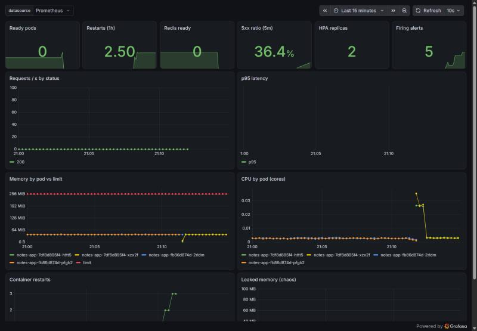
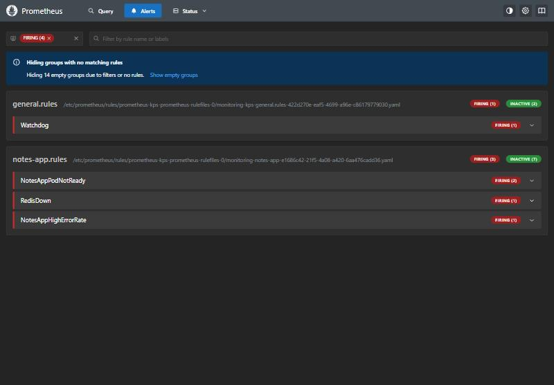

# MCP examples: how Claude talks to the cluster

Every example below was captured from a real Claude Code session against the
`ai-debug` kind cluster, using only the read-only `kubernetes` MCP server
(`kubernetes-mcp-server` with the `core` and `observability/metrics` toolsets).
Outputs are trimmed for length; nothing else is edited.

- [1. Cluster health check](#1-cluster-health-check)
- [2. Traffic and memory headroom with PromQL](#2-traffic-and-memory-headroom-with-promql)
- [3. Live incident: a release that crashes on start](#3-live-incident-a-release-that-crashes-on-start)
- [4. Live incident from an alert: Redis down](#4-live-incident-from-an-alert-redis-down)
- [5. Guardrails: what the AI is not allowed to do](#5-guardrails-what-the-ai-is-not-allowed-to-do)

---

## 1. Cluster health check

> **Prompt:** *Give me a health summary of the cluster and the demo-app namespace.*

| # | Tool | Arguments |
|---|---|---|
| 1 | `nodes_top` | – |
| 2 | `pods_list_in_namespace` | `namespace: demo-app` |
| 3 | `get_alerts` | `active: true` |
| 4 | `events_list` | `namespace: demo-app`, `fieldSelector: type=Warning`, `limit: 5` |

```jsonc
// nodes_top
{"Name":"ai-debug-control-plane","CPU":"278864897n","Memory":"1129648Ki"}
{"Name":"ai-debug-worker",       "CPU":"114640097n","Memory":"1025640Ki"}
{"Name":"ai-debug-worker2",      "CPU":"176666533n","Memory":"945344Ki"}

// pods_list_in_namespace
{"Name":"notes-app-fb86d874d-2rldm","Node":"ai-debug-worker", "Ready":"1/1","Restarts":"0","Status":"Running"}
{"Name":"notes-app-fb86d874d-pfgb2","Node":"ai-debug-worker2","Ready":"1/1","Restarts":"0","Status":"Running"}
{"Name":"redis-0",                  "Node":"ai-debug-worker2","Ready":"1/1","Restarts":"0","Status":"Running"}

// get_alerts
{"alerts":[{"labels":{"alertname":"Watchdog","severity":"none"}, ...}]}

// events_list (warnings)
{"items":[]}
```

**Claude's answer:** All 3 nodes are up with low usage (0.11–0.28 cores, ~1 GiB each).
Both `notes-app` replicas and `redis-0` are `1/1 Running` with 0 restarts. The only
alert is `Watchdog`, the always-on heartbeat that proves alerting works. No warning
events in `demo-app`. The cluster is healthy.

---

## 2. Traffic and memory headroom with PromQL

> **Prompt:** *How much traffic is each notes-app pod serving, and how close are they to their memory limit?*

| # | Tool | Arguments |
|---|---|---|
| 1 | `list_metrics` | `name_regex: (http_requests_total\|container_memory_working_set_bytes\|kube_pod_container_resource_limits)` |
| 2 | `execute_instant_query` | request rate per pod |
| 3 | `execute_instant_query` | memory used ÷ memory limit per pod |

```promql
# 2: requests per second, per pod
sum by (pod) (rate(http_requests_total{namespace="demo-app"}[5m]))

# 3: share of the memory limit in use
max by (pod) (container_memory_working_set_bytes{namespace="demo-app",container="notes-app"})
  / on (pod)
max by (pod) (kube_pod_container_resource_limits{namespace="demo-app",container="notes-app",resource="memory"})
```

```jsonc
// 2
{"pod":"notes-app-fb86d874d-2rldm","value":"0.3649"}
{"pod":"notes-app-fb86d874d-pfgb2","value":"0.3684"}
// 3
{"pod":"notes-app-fb86d874d-2rldm","value":"0.1584"}
{"pod":"notes-app-fb86d874d-pfgb2","value":"0.1593"}
```

**Claude's answer:** Traffic is balanced: each pod serves about 0.37 req/s (mostly
probes and the demo page). Each uses about 16% of its 256 MiB limit (~40 MiB), so
there is plenty of memory headroom.

---

## 3. Live incident: a release that crashes on start

Broken with `.\scenarios\chaos.ps1 -Scenario crashloop`, then:

> **Prompt:** *Something is wrong with notes-app in demo-app. Investigate with the MCP tools only.*

| # | Tool | Arguments | What it showed |
|---|---|---|---|
| 1 | `pods_list_in_namespace` | `labelSelector: app.kubernetes.io/name=notes-app` | New pod `CrashLoopBackOff`, 3 restarts; old pods still `1/1` |
| 2 | `events_list` | `fieldSelector: type=Warning` | `Startup probe failed … connection refused`, `Back-off restarting failed container` |
| 3 | `pods_log` | `previous: true`, `tail: 6` | Python traceback (below) |
| 4 | `resources_get` | `v1 ConfigMap notes-app-config` | `REDIS_PORT: "six-three-seven-nine"` |

```text
// pods_log (previous container)
  File "/app/main.py", line 30, in <module>
    REDIS_PORT = int(os.getenv("REDIS_PORT", "6379"))
ValueError: invalid literal for int() with base 10: 'six-three-seven-nine'
```

```jsonc
// resources_get ConfigMap
"data": {"REDIS_HOST":"redis","REDIS_PORT":"six-three-seven-nine", ...},
"kubectl.kubernetes.io/last-applied-configuration": "... \"REDIS_PORT\":\"6379\" ..."
```

**Claude's answer:**
- **Symptom:** the new ReplicaSet's pod crash-loops; the rollout is stuck.
- **Root cause:** `REDIS_PORT` in ConfigMap `notes-app-config` was changed to the
  non-numeric `six-three-seven-nine`; the app's `int()` parse fails at import. The
  last-applied annotation shows the previous value was `6379`.
- **Impact:** none yet. `maxUnavailable: 0` keeps the two old pods serving.
- **Fix:** set `REDIS_PORT: "6379"` and `kubectl -n demo-app rollout restart deploy/notes-app`.

4 tool calls, no kubectl.

---

## 4. Live incident from an alert: Redis down

Broken with `.\scenarios\chaos.ps1 -Scenario redis-down`, waited ~2 minutes, then:

> **Prompt:** *What alerts are firing? Find the root cause and show the PromQL you used.*

| # | Tool | Arguments |
|---|---|---|
| 1 | `get_alerts` | `active: true`, `filter: alertname!=Watchdog` |
| 2 | `execute_range_query` | Redis ready replicas, last 5m, step 30s |
| 3 | `execute_instant_query` | ready state of each notes-app pod |
| 4 | `resources_get` | `apps/v1 StatefulSet redis` |

```jsonc
// get_alerts (trimmed)
{"alertname":"RedisDown",           "severity":"critical","statefulset":"redis",
 "summary":"Redis has no ready replicas; notes-app cannot store or read notes."}
{"alertname":"NotesAppPodNotReady", "severity":"warning","pod":"notes-app-7df8d895f4-httt5"}
{"alertname":"NotesAppPodNotReady", "severity":"warning","pod":"notes-app-7df8d895f4-xzx2f"}
```

```promql
kube_statefulset_status_replicas_ready{namespace="demo-app",statefulset="redis"}   # range 5m
sum by (pod) (kube_pod_status_ready{namespace="demo-app",condition="true"})         # instant
```

```jsonc
// range query summary
{"statefulset":"redis","firstValue":1,"lastValue":0,"min":0,"max":1,"delta":-1}
// instant query
{"pod":"notes-app-7df8d895f4-xzx2f","value":"0"}
{"pod":"notes-app-7df8d895f4-httt5","value":"0"}
// StatefulSet
"spec": {"replicas": 0, ...}
"last-applied-configuration": "... \"replicas\":1 ..."
```

**Claude's answer:**
- **Symptom:** `RedisDown` (critical) and `NotesAppPodNotReady` on both app pods.
- **Root cause:** StatefulSet `redis` was scaled to `replicas: 0` (manifest says 1).
  Ready replicas dropped from 1 to 0 within the last 5 minutes.
- **Impact:** both app pods fail `/readyz` (it pings Redis), so the Service has no
  endpoints and the website returns 503. Grafana showed a 36% 5xx ratio.
- **Fix:** `kubectl -n demo-app scale statefulset redis --replicas=1`.

What you see at the same moment:

| Grafana: Notes App dashboard | Prometheus: firing alerts |
|---|---|
|  |  |

---

## 5. Guardrails: what the AI is not allowed to do

```text
resources_list  v1 Secret  namespace=demo-app
→ failed to list resources: ... resource not allowed: /v1, Kind=Secret
```

- Write tools (`pods_delete`, `resources_scale`, `resources_create_or_update`,
  silence create/delete) are **not registered** because `read_only = true`.
- Even if they were, the `mcp-viewer` ServiceAccount has no write verbs, no
  `pods/exec` and no `nodes/proxy` (checked with `kubectl auth can-i`).
- The server's kubeconfig contains only the kind cluster, so other contexts on the
  machine (e.g. a cloud EKS cluster) are unreachable.
